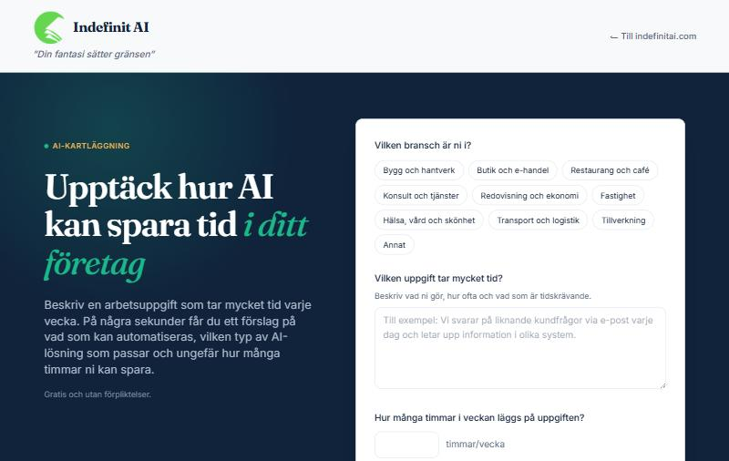
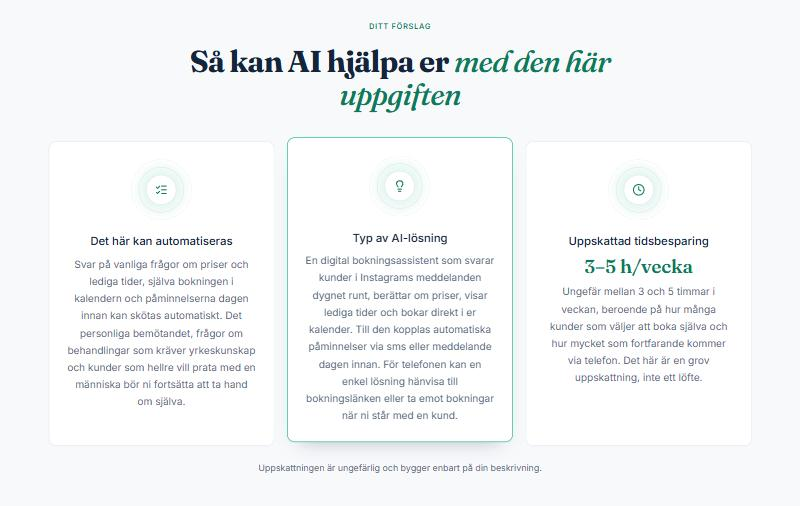
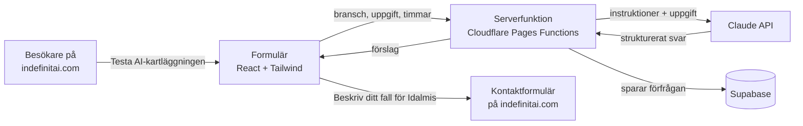

# AI-kartläggning

**Ett webbverktyg som visar små svenska företag hur AI kan spara tid i deras återkommande arbetsuppgifter.**

🔗 **Live:** [kartlaggning.indefinitai.com](https://kartlaggning.indefinitai.com) · del av [indefinitai.com](https://indefinitai.com)

Byggt av **Idalmis Figueredo** för Indefinit AI, med Claude Code.



---

## Vilket problem löser det – och för vem?

Många småföretagare vet att de lägger för mycket tid på samma uppgifter varje vecka, men vet inte vad AI faktiskt skulle kunna göra åt det. Att boka ett möte med en konsult bara för att få veta det är ett stort steg.

AI-kartläggning sänker tröskeln. Företaget beskriver en uppgift med egna ord och får **på några sekunder, gratis och utan att lämna några uppgifter**:

1. vad i uppgiften som kan automatiseras – och vad som bör fortsätta göras av en människa,
2. vilken *typ* av AI-lösning som skulle passa, förklarat utan teknisk jargong,
3. en ungefärlig uppskattning av hur många timmar per vecka som kan sparas.

För Indefinit AI är varje förfrågan ett första samtal med en möjlig kund. Verktyget är **steg ett**; steg två är en personlig analys via kontaktformuläret på indefinitai.com.



*Ett riktigt svar för en frisörsalong som lägger sju timmar i veckan på bokningar och påminnelser.*

---

## Så fungerar det



1. Besökaren väljer bransch, beskriver uppgiften och anger timmar per vecka. Namn och e-post är frivilliga.
2. Webbläsaren skickar uppgifterna till en **serverfunktion**. API-nyckeln finns bara där, aldrig i webbläsaren.
3. Serverfunktionen skickar uppgiften till **Claude** tillsammans med fasta instruktioner (se nedan) och kräver ett svar i en fast struktur (*structured outputs*).
4. Svaret visas som tre kort, och förfrågan sparas i **Supabase**.
5. Under förslaget leds besökaren vidare till Idalmis kontaktformulär för en riktig analys.

### Instruktionerna till Claude

Claude agerar rådgivare på Indefinit AI och följer några fasta regler (se [`functions/api/forslag.ts`](functions/api/forslag.ts)):

- svara alltid på svenska, tydligt och utan jargong,
- beskriv *typ* av lösning, inte varumärken – att välja verktyg är konsultens jobb,
- var realistisk: inga löften, och uppskattningen ska vara ett intervall,
- säg vänligt till om beskrivningen är för vag, och ärligt om AI inte passar,
- kommentera aldrig personuppgifter.

Regeln att besparingen **aldrig får vara större än de timmar företaget uppger** kontrolleras dessutom i koden, inte bara i instruktionerna.

---

## Teknik och kopplingar

| Del | Verktyg | Varför |
|---|---|---|
| Gränssnitt | **React 19**, **TypeScript**, **Tailwind CSS 4**, Vite | Komponentbaserat, och samma teknik som komponenterna på 21st.dev |
| Design | Inspirerad av komponenter från **21st.dev**, anpassad till indefinitai.com:s varumärke | Ska kännas som en del av huvudsajten |
| AI | **Claude API** (Claude Opus 5.5) via Anthropics officiella SDK | Strukturerade svar, och automatisk reservmodell om en förfrågan avböjs |
| Server | **Cloudflare Pages Functions** | Håller API-nycklarna hemliga |
| Databas | **Supabase** (Postgres) | Sparar varje förfrågan |
| Publicering | **Cloudflare Pages**, kopplat till GitHub | Varje `git push` publiceras automatiskt |
| Domän | `kartlaggning.indefinitai.com` | En underdomän till huvudsajten |

---

## Säkerhet och integritet

- **Inga nycklar i repot.** Lokalt ligger de i `.dev.vars`, som git ignorerar (se `.gitignore` och mallen [`.dev.vars.example`](.dev.vars.example)). I produktion är de krypterade hemligheter i Cloudflare. Inför varje commit kontrollerades att ingen nyckel följde med.
- **Databasen är stängd utåt.** Tabellen har radnivåsäkerhet (RLS) påslagen utan några policyer, så webbläsaren kan varken läsa eller skriva. Bara serverfunktionen kommer åt den (se [`supabase/schema.sql`](supabase/schema.sql)).
- **GDPR.** Namn och e-post är frivilliga och sparas bara om besökaren själv fyller i dem, med en kort text om hur de används. De skickas **aldrig** till Claude.
- **Ett fel i databasen stoppar aldrig svaret** till besökaren: sparandet sker i bakgrunden.

---

## Så byggdes det med Claude Code

Jag ledde projektet som produktägare och AI-specialist: jag skrev kravspecifikationen (PRD) och instruktionerna till Claude, och fattade besluten om produkt, design, integritet och publicering. Claude Code skrev koden under min ledning, ett steg i taget och med **en commit per steg**, och förklarade varje kommando innan det kördes – ett arbetssätt där AI förstärker den som styr. Hela historiken finns i [commit-loggen](https://github.com/ladywillyjesus/ai-kartlaggning/commits/main).

| Steg | Vad som gjordes |
|---|---|
| 1 | Repo på GitHub, `.gitignore` från första commit, `CLAUDE.md` med projektets regler för Claude Code |
| 2 | Startsida med introduktion och formulär, utan kopplingar |
| 3 | Design inspirerad av 21st.dev, därefter anpassad till indefinitai.com:s varumärke |
| 4 | Koppling till Claude API med instruktionerna från PRD:n |
| 5 | Förfrågningar sparas i Supabase |
| 6 | Publicering på Cloudflare Pages med egen domän |
| 7 | Knapp på indefinitai.com, och länk från förslaget till kontaktformuläret |
| 8 | Denna README |

**Beslut och lärdomar på vägen:**

- **Varumärket först.** Färgen ändrades först till logotypens limegröna. När vi upptäckte att huvudsajten redan har en egen *Brand Book* (smaragdgrönt, Fraunces och Inter, inga robotikoner) anpassades verktyget till den, så att besökaren inte märker att hen "byter webbplats".
- **21st.dev.** Planen var att hämta komponenter via 21st.dev:s MCP-server. I praktiken återskapades formuläret och förslagskorten *inspirerade av* två komponenter därifrån ("Contact" av Ravi Katiyar och "Feature Problem Cards" av Mohammad Shehadeh), medan kontaktraden bygger på komponenten "ContactCards", anpassad till svenska.
- **Två vägar in, ett flöde.** Huvudsajten hade redan ett kontaktformulär med en liknande fråga. I stället för att låta dem konkurrera blev verktyget det snabba första steget och formuläret det personliga andra steget, och de länkar till varandra.
- **Mobilen styr.** En fjärde länk i huvudsajtens meny fick inte plats på mobil, så den visas bara på större skärmar. På mobil leder en framhävd remsa direkt efter heron till verktyget.
- **Säker publicering.** Huvudsajten publiceras från en ren mapp som bara innehåller webbplatsens egna filer, så att inga privata dokument kan följa med av misstag.

---

## Vad projektet visar

- **Promptdesign:** en systemprompt med tydlig roll, ton och regler, inklusive ärlighet när AI *inte* passar.
- **Strukturerade AI-svar:** Claude svarar enligt ett JSON-schema som gränssnittet kan lita på, och affärsregler kontrolleras i koden.
- **Integration av flera tjänster:** Claude API, Supabase, Cloudflare och GitHub i ett och samma flöde.
- **Säkerhet och GDPR i praktiken:** hemligheter utanför koden, en databas som är stängd utåt, och minsta möjliga datadelning.
- **Från idé till produktion:** kravspecifikation, versionshantering, automatisk publicering och egen domän.
- **AI-driven utveckling:** ett verkligt projekt byggt med Claude Code, där människan styr och AI:n bygger.

---

## Projektstruktur

```
├── functions/api/forslag.ts   Serverfunktionen: validering, Claude, Supabase
├── src/
│   ├── App.tsx                Sidan: header, hero, resultat, sidfot
│   ├── components/
│   │   ├── KartlaggningForm.tsx   Formuläret med branschval
│   │   ├── ForslagKort.tsx        De tre förslagskorten
│   │   ├── Kontakt.tsx            Nästa steg: länk till kontaktformuläret
│   │   └── ui/contact-cards.tsx   Kontaktrad (baserad på 21st.dev)
│   └── index.css              Varumärkets färger och typsnitt (Tailwind-tokens)
├── supabase/schema.sql        Databastabellen
├── CLAUDE.md                  Projektets regler för Claude Code
└── wrangler.toml              Cloudflare-konfiguration (inga hemligheter)
```

## Köra lokalt

```bash
npm install
cp .dev.vars.example .dev.vars   # fyll i dina egna nycklar
npm run dev:full                 # bygger och startar på http://localhost:8788
```

---

## Utanför denna version

Adminpanel, betalningar, användarkonton och flera språk. En naturlig nästa förbättring är ett e-postmeddelande till Indefinit AI när en besökare lämnar sina kontaktuppgifter.

---

## Om mig

Jag heter **Idalmis Figueredo**, AI-utvecklare och grundare av [Indefinit AI](https://indefinitai.com) i Timrå. Jag har en magisterexamen i biokemi (Universidad de La Habana, bedömd av UHR) och studerar sedan snart tre år AI vid Learning Heroes. 2025 tog jag certifikatet IA Heroes Pro (1 080 timmar, inom promptdesign, AI-verktyg, chattbotar och automatisering), och mitt andra certifikat, med högskolepoäng tillgodoräknade av Western European University (WEU), är godkänt med 97 % på slutprovet. Diplomet delas ut i november 2026.

Mitt arbetssätt är enkelt: först förstå företagets problem, sedan lösa det med AI så att det sparar tid och pengar.

[LinkedIn](https://www.linkedin.com/in/idalmis-maria-figueredo-alarcon-685393361/) · [info@indefinitai.com](mailto:info@indefinitai.com)
